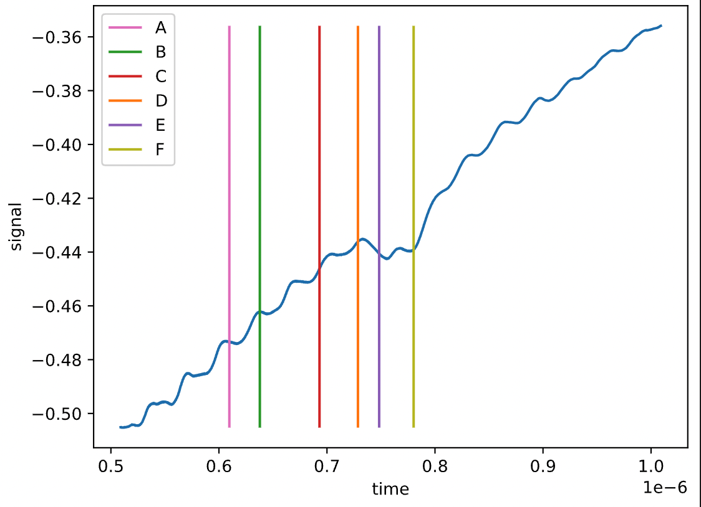
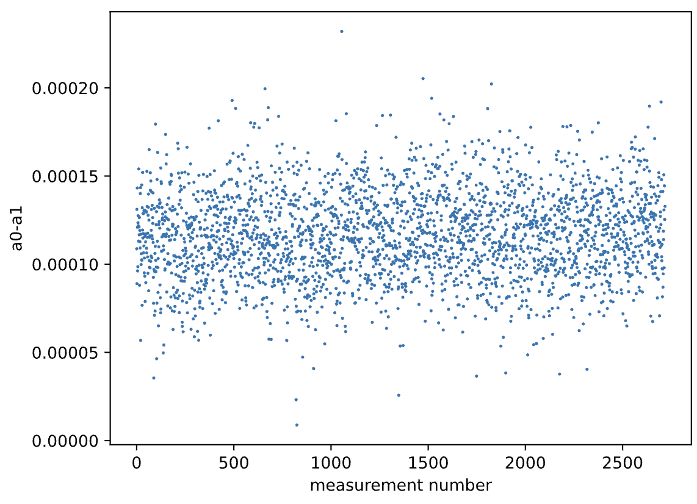
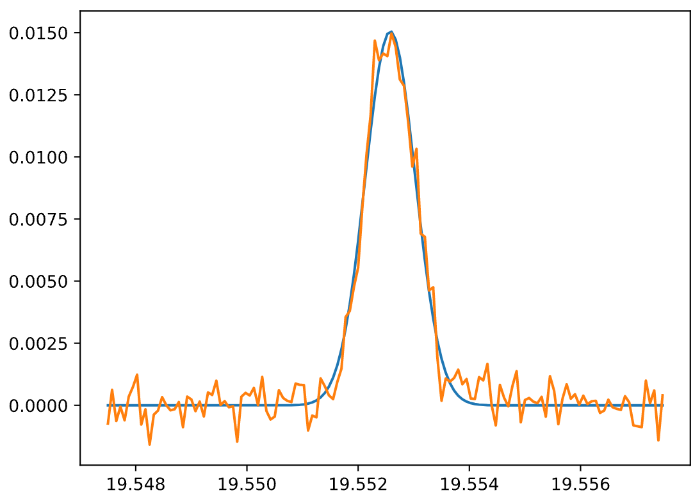
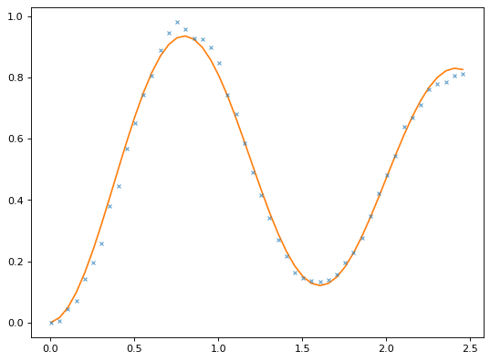

# Scan Data Object
My personal library for working with data from the E11 lab. The data format used in the lab is HDF5. All the data from an experiment is included in this file, including metadata. The files can be read for analysis using the [h5py](https://www.h5py.org) library. A description of the Scan object is below as well as a reference section can be found below that outlines the structure of these files.

## Architecture

The library is structured into three modules:

| Module | Purpose |
|--------|---------|
| `e11scan/core.py` | Pure functions: HDF5 loading, signal evaluation, baseline subtraction, filtering |
| `e11scan/fitting.py` | Standalone fitting routines (Gaussian, double Gaussian, Rabi) — no HDF5 dependency |
| `e11scan/main.py` | User-facing `Scan` and `ScanMD` classes with lazy-cached fit properties |

All existing notebook code (`from e11scan import scan`) continues to work unchanged. Fitting is performed lazily on first property access and then cached — no fitting runs during object construction.

## Quick Start

How to use Scan object:
```
from e11scan import scan
filename = 'tests/20210707_005_scan.h5'
function = '-(a0 - a1)/((a0 - a1) + (a0 - a2))'
sc = scan(filename = filename, function = function)
```
The scan object automatically processes the data by grouping and averaging measurements made at the same point and subtracting a baseline value. The baseline that is subtracted depends on the type of the experiment. The experiment type is read from the metadata in the h5py file.

Experiment Types
- microwave:
    - Baseline processing: baseline calculated from the signal of the lowest 10 microwave frequencies.
- volt:
    - No baseline subtracted
- time: 
    - Baseline calculated from the signal measured for the lowest time value.
- generic: 
    - No baseline subtracted

The experiment type used can also be set manually:
```
scan(filename = filename, function = function, experiment = 'experiment')
```

Change the evaluation function:
```
>>> function = 'a0 - a1'
>>> sc.update_function(function)
```

Accessing data:
- Independent variable: `sc.x`
- Dependent variable: `sc.y`
- Without averaging:
    - Independent variable: `sc.xall`
    - Dependent variable: `sc.yall`

Access an individual trace:
```
times, signal = sc.trace(index)
```

Access locations of windows:
```
>>> sc.windows
{'A': 1.0063636363636365e-07,
 'B': 1.288636363636364e-07,
 'C': 1.840909090909091e-07,
 'D': 2.196818181818182e-07,
 'E': 2.3931818181818186e-07,
 'F': 2.7122727272727274e-07}
```
The location of the windows are in reference to the first time on the scope i.e. ``self.f['osc_0'].attrs['t0']``.

Plot a trace with location of windows:
```
>>> sc.plot_trace(index)
```


Plot the stability of the signal:
```
>>> sc.plot_stability()
```


By default, the function `a0 - a1` is used. A custom function can also be used e.g `sc.plot_stability(customfunction = a0-a2)`

## Fitting Routines
Basic fitting routines for fitting oscillatory data and Gaussian peaks are included. The best fit values `p0` and variance matrix `varMatrix` can be accessed through a scan object i.e.

### Gaussian
$$
A  e^{- \frac{(x-\mu)^2}{2 \sigma^2}}
$$

```
>>> sc = scan(filename, function)
>>> sc.Gauss.p0
array([8.90789113e-03, 1.95563556e+01, 6.64935890e-05])

>> sc.varMatrix
array([[ 2.82771663e-08,  6.16810598e-13, -1.40790216e-10],
       [ 6.16810598e-13,  2.10294996e-12, -4.60657391e-15],
       [-1.40790216e-10, -4.60657391e-15,  2.10293986e-12]])
```
`p0()` and `varMatrix()` returns fit parameters in the order: `[A, mu, sigma]`

It is also possible to return the values predicted by the model.
```
>> sc = scan(filename, function)
>> plt.plot(sc.x, sc.gauss.fit)
```


### Gaussgauss

A double Gaussian fit for two-peak spectra.

$$
A_\mathrm{p} \, e^{- \frac{(x-\mu_\mathrm{p})^2}{2 \sigma_\mathrm{p}^2}}
\;+\;
A_\mathrm{s} \, e^{- \frac{(x-\mu_\mathrm{s})^2}{2 \sigma_\mathrm{s}^2}}
$$

The **primary** peak is the most prominent (tallest) peak; the **secondary** peak is the less prominent peak. This is *not* necessarily left-to-right ordering — prominence is determined by scipy's peak finding, not by x-position.

`p0()` is returned in the order: `[A_primary, mu_primary, sigma_primary, A_secondary, mu_secondary, sigma_secondary]`

```
>>> sc.gaussgauss.param_names
('A_primary', 'mu_primary', 'sigma_primary', 'A_secondary', 'mu_secondary', 'sigma_secondary')

>>> dict(zip(sc.gaussgauss.param_names, sc.gaussgauss.p0))
{'A_primary': 0.8, 'mu_primary': 19.56, 'sigma_primary': 6.6e-05,
 'A_secondary': 0.3, 'mu_secondary': 19.52, 'sigma_secondary': 5.1e-05}
```

### Rabi

$$
A (1 - \cos(\omega t)) e^{-t/T_{2}}/2
$$

The fitting routine is performed subtracting the first element of scan.y from y, such that the oscillation starts at the origin.

`p0()` is returned in the order: `[omega, t2, A]`

```
>>> sc = scan(filename, function)
>>> plt.errorbar(sc.x, (sc.y-sc.y[0])/sc.rabi.p0[2], sc.error, ls='none', marker='x', markersize=3, elinewidth=1,alpha=0.7)
>>> plt.plot(sc.x, (sc.rabi.func(sc.x, *sc.rabi.p0))/sc.rabi.p0[2], label='fit')
```


### Interpolation
All fitting routines can be used to interpolate the data. The interpolated fit can be accessed using `sc.gauss.fit_interpolated(interpolation = 100)` or `sc.rabi.fit_interpolated(interpolation=100)`. Where the interpolation is the factor by which the number of points is increased. The default interpolation is 100.

```
>>> x,y = sc.gauss_fit_interpolated()
```


## Two Dimensional Scans
It is possible to perform measurements in two dimensions - with a range of values in both `v0` and `v1`. For this type of analysis use the `scanmd` object. This object builds a list (`scanmd.sets`) of `scan` objects for each dataset associated with independent values of `v1`.  Each `scan` object contains the values of `v0` accessible through `scanmd.sets[0].x` as well as the associated `v1` value accessible through `scanmd.set[0].x2`.

```
>>> scs = scanmd(filename = 'filename_of_twodimensional_dataset', function= 'a0-a1')

>>> for sc in scs.sets:
>>>    plt.plot(sc.x, sc.y, label = sc.x2)
```

## Changing windows
The position of the windows can be changed by defining a new set of indices for the window locations. An example of checking the current window locations, changing the window locations, and viewing the updated locations is shown below. The new window locations are not written to file.

```
>>> sc.windowsind
{'A': 201, 'B': 257, 'C': 368, 'D': 439, 'E': 478, 'F': 542}

>>> sc.plot_trace(0) # Check current windows

>>> windows = {'A': 210, 'B': 247} # Define new windows

>>> sc.windowsind  = windows

>>> sc.plot_trace(0) # Check new windows
```

## Filtering

The Scan object provides a non-destructive, reversible filtering system. All filters operate on a pristine copy of the raw data — nothing is permanently removed until you explicitly reset the pipeline. You can enable, disable, tweak, or reorder filters at any time without losing data.

Filters are configured as an ordered list of steps stored in `sc.pipeline`. Each step is applied in sequence during every rebuild of the processed data. The available filter steps are:

| Step name | What it does |
|-----------|-------------|
| `drop_rows` | Excludes specific rows by their DataFrame index |
| `filter_rows` | Keeps only a contiguous range of rows (start, end) |
| `basic_filter` | Removes outlier data points using a relative spacing threshold |
| `remove_unstable` | Removes measurements where a stability metric exceeds a threshold |

### Setting a pipeline

Use `set_pipeline` to declare the full filter sequence in one call. The order you specify is the order in which filters are applied:

```
>>> sc.set_pipeline([
...     ('drop_rows', [50, 150]),
...     ('filter_rows', (20, 280)),
...     ('basic_filter', 1.5),
...     ('remove_unstable', 0.01),
... ])
```

You can inspect the current pipeline at any time:
```
>>> sc.pipeline
[('drop_rows', {'indices': [50, 150]}),
 ('filter_rows', {'rows': (20, 280)}),
 ('basic_filter', {'m': 1.5}),
 ('remove_unstable', {'threshold': 0.01, 'customfunction': 'a0-a1'})]
```

### Adding and inserting steps

Use `add_step` to build a pipeline incrementally. By default, steps are appended to the end:

```
>>> sc.clear_pipeline()
>>> sc.add_step('basic_filter', 1.5)
>>> sc.add_step('filter_rows', (20, 280))
```

Pass `order=` to insert a step at a specific position:
```
>>> sc.add_step('drop_rows', [50, 150], order=0)  # insert before everything else
```

### Disabling and re-enabling filters

Calling any of filter methodst with `None` removes that filter from the pipeline:

```
>>> sc.basic_filter(1.5)
>>> sc.basic_filter(None)   # disables the filter, data is fully restored
```

### Resetting the pipeline

Remove all filters and restore the pristine, unfiltered dataset:
```
>>> sc.clear_pipeline()
```

### Comparing filter orders

Because the pipeline order is user-controlled, you can easily compare the effect of applying filters in different sequences:

```
>>> sc.set_pipeline([('drop_rows', [50, 150]), ('filter_rows', (20, 280))])
>>> result_a = sc.y.copy()

>>> sc.set_pipeline([('filter_rows', (20, 280)), ('drop_rows', [50, 150])])
>>> result_b = sc.y.copy()
```

### Filter details

**`drop_rows`** — Takes a list of integer indices. Rows matching those indices are removed from the raw DataFrame before any other processing. Useful for dropping known-bad measurement points.

**`filter_rows`** — Takes a `(start, end)` tuple. Behaves like `DataFrame.iloc[start:end]` — keeps rows from index `start` up to (but not including) `end`. Pass `None` for either value to leave that end unbounded, e.g. `(10, None)` drops the first 10 rows but keeps everything after.

**`basic_filter`** — Takes a float `m`. For each measurement group, if the gap between the first two sorted signal values exceeds `m` times the gap between the second and third, the extreme point is dropped. A typical value is `1.5`.

**`remove_unstable`** — Takes a float `threshold` and an optional `customfunction` string (default `'a0-a1'`). Any measurement where the evaluated function exceeds the threshold is removed. Useful for filtering out drift or instability in the experiment.

### Working with osc_1 traces

Some HDF5 files contain a second oscilloscope channel (`osc_1`). You can check for it with `sc.has_osc_1` and access its traces by passing `channel='osc_1'` to `trace()`:

```
>>> sc = e11scan.scan('data_with_two_channels.h5', function='a0 - a1')
>>> sc.has_osc_1
True

>>> tt, signal = sc.trace(0, channel='osc_1')
>>> plt.plot(tt, signal)
```

`osc_1` traces are read-only and not included in the signal analysis pipeline — they are there for you to inspect and process manually. When you identify bad traces from `osc_1`, drop them using `filter_drop_rows` with the same indices (the two channels share the same trace ordering):

```
>>> # Inspect osc_1 traces and find bad ones
>>> bad = []
>>> for i in range(sc.numtraces):
...     _, sig = sc.trace(i, channel='osc_1')
...     if np.max(sig) < 0.05:
...         bad.append(i)

>>> # Drop them — this also removes the corresponding osc_0 rows
>>> sc.filter_drop_rows(bad)
```


## Error Calculation
For a full calculation of the error the distribution functions of the states must be known. If the states do not overlap then a calculation of the standard error of each data point can be estimated. To calculate the standard error the standard deviation of each measurement must be known.

An estimation of the standard deviation of each measurement can be made by treating the measurements, $x_i$, as Bernoulli trial (only valid if the distributions do not overlap):
$$
\sigma_\mathrm{x_i} = \sqrt{\frac{pq}{n}}
$$
where $p$ is the probability of success, $q = 1 - p$, and $n$ is the number of averages on the oscilloscope. The error is then calculated by setting $p$ equal to the signal calculated using data from the oscilloscope and the windows. This is only valid if the value of the signal has been correctly normalized. If this is not the case then an overestimate of the error can be made by setting $p=0.5$.

If standard error can then be calculated by considering the number of loops:


##  Reference: File structure
A file can be loaded using 
```
f = h5py.File('FILENAME', 'r')
```
The file is also accessible from the Scan object:
```
>>> sc = scan(filename = 'FILENAME', function = 'a0')
>>> sc.f
<HDF5 file "20210707_005_scan.h5" (mode r)>

```
The metadata associated with the file is stored as a proxy object accessible using key value pairs through `f.attrs`. The metadata available depends on which oscilloscope was used.


Example (agilent):
```
>>> sc.f.attrs.keys()
<KeysViewHDF5 ['run_ID', 'timestamp', 'v0_loops', 'v0_num', 'v0_options', 'v0_repeats', 'v1_loops', 'v1_num', 'v1_options', 'v1_repeats', 'var 0', 'var 1']>
```
| `key`     |Description|
|--------------|--------------------------------------------------------|
| `run_ID`     | Date of file and measurement number i.e. `20210707_005` |
| `timestamp`  | i.e. `2021-07-07 15:04:14`                              |
| `v0_loops`   | Number of measurement loops on `v0`                    |
| `v0_num`     | Number of measurements on `v0`                        |
| `v0_options` |                                                        |
| `v0_repeats` |                                                        |
| `v1_loops`   |                                                        |
| `v1_num`     |                                                        |
| `v1_options` |                                                        |
| `v1_repeats` |                                                        |                                                |
| `var 0`      | Type of measurement i.e. `microwaves (GHz)`             |
| `var 1`      |                                                        |

Alternative Example (lecroy)
| `key`                | Description                                               |
|----------------------|-----------------------------------------------------------|
| `num_rows`           |                                                           |
| `run_id`             | Date of file and measurement number i.e.   `20210707_005` |
| `scope_VISA`         | Visa name i.e `lecroy`                                    |
| `scope_averages`     | Number of averages used by scope                          |
| `scope_channels`     | Channel number                                            |
| `scope_max_points`   | Number of points                                          |
| `scope_noise filter` |                                                           |
| `scope_timeout (ms)` |                                                           |
| `timestamp`          | i.e `2021-07-07 15:04:14`                                 |
| `v0_VISA`            | Extra visa info i.e. `COM 4`                              |
| `v0_hardware`        |                                                           |
| `v0_loops`           | Number of measurement loops on `v0`                       |
| `v0_options`         |                                                           |
| `v0_repeats`         |                                                           |
| `v1_hardware`        |                                                           |
| `v1_loops`           |                                                           |
| `v1_options`         |                                                           |
| `v1_repeats`         |                                                           |

Each file has two datasets:
- `analysis`: Data after applying windows
- `osc_0`: Data before applying windows 

Each of these datasets also has an associated `attrs` object containing useful metadata as well the data itself.

### analysis
The metadata associated with analysis includes the location of the windows as well as the function used to perform analysis in the e11 control software.

```
>>> sc.f['analysis'].attrs.keys()
<KeysViewHDF5 ['A', 'B', 'C', 'D', 'E', 'F', 'a0 ', 'a1', 'a2', 'f']>
```

The data can be read into a pandas data frame using:

```
>>> import pandas as pd
>>> df = pd.DataFrame.from_records(sc.f['analysis'], columns = sc.f['analysis'
].dtype.fields.keys())
```

The dataframe then has columns: `v0, v1, w0, w1, a0, a1, a2`.

### osc_0
This contains the time of arrival data stored on the oscilloscope. The metadata includes the `t0` and `dt` time step information.

```
>>> sc.f['osc_0'].attrs.keys()
<KeysViewHDF5 ['dt', 't0']>
```

The individual scans can be loaded into a dataframe using:
```
pd.DataFrame.from_records(sc.f['osc_0'])
```
Or accessed using:
```
sc.f['osc_0'][index]
```


# Instillation
```
pip install git+https://github.com/lukelbro/scan
```


